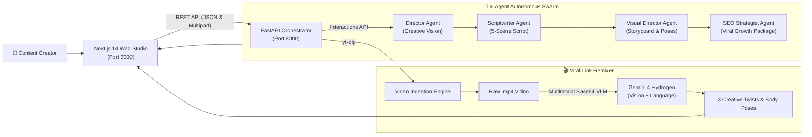

# 🎬 Creator OS — Personal AI Creative Studio & Viral Remixer (MVP)

> *"From a random idea or viral link to a creative masterpiece. AI handles the workflow. Humans own the creativity."*

[](https://python.org)
[](https://fastapi.tiangolo.com)
[](https://nextjs.org)
[](https://www.typescriptlang.org)
[](https://tailwindcss.com)
[](https://ai.google.dev)

---

## ⚡ Overview & Product Vision

**Creator OS** is an all-in-one AI creative studio built for modern content creators (YouTubers, Instagram creators, digital artists, and creative teams). It combines two flagship workflows:

1. **✨ Blank-Slate Idea-to-Masterpiece Studio:**
   Transform a rough prompt, voice note, or reference concept into a comprehensive creative direction, 5-scene dialogue script, visual storyboard with color palettes and camera angles, 7-day publishing schedule, and cross-platform SEO package.
2. **🎬 Viral Link Remixer (Multimodal VLM Intelligence):**
   Paste any Instagram Reel, YouTube Short, or TikTok URL (or upload an `.mp4`). Our Vision-Language model (`gemini-4-hydrogen`) analyzes the video, diagnoses why it captured millions of views, and generates **3 distinct Creative Twists**, **exact body poses & camera framing guides**, and **platform-specific distribution strategies**.
3. **🧬 Creative DNA Personalization Engine:**
   Calibrate your creator profile by niche, visual aesthetic, content tone, target audience, and primary platforms. Every generated script, hook, and pose is mathematically tailored to your creative brand.

---

## 🏗️ System Architecture



---

## 📦 Core MVP Studio Modules

| Module | Route | Status | Capability |
|---|---|---|---|
| **Dashboard** | `/` | 🟢 Active | Performance metrics, creator streaks, quick actions, recent activity, trending hashtags |
| **Creative DNA** | `/dna` | 🟢 Active | Niche, visual style, tone, audience & platform fingerprint engine with 85% strength meter |
| **AI Studio** | `/studio` | 🟢 Active | Dual-tab Idea-to-Masterpiece & Viral Link Remixer with live 4-Agent Swarm progress feed |
| **Script Studio** | `/script` | 🟢 Active | Responsive 3-pane scene selector, dialogue script editor, storyboard preview & export |
| **Caption & SEO** | `/seo` | 🟢 Active | Platform tabs (IG, YT, TikTok, LinkedIn), character counters & 1-click hashtag copy bank |

---

## 🚀 One-Command Quick Start

### 1. Launch the Studio
From the root directory, simply run:
```bash
./start.sh
```
`start.sh` automatically:
- Creates and sets up the Python virtual environment (`backend/venv`)
- Verifies backend dependencies (`fastapi`, `uvicorn`, `google-genai`, `yt-dlp`, etc.)
- Starts the FastAPI backend on **`http://localhost:8000`**
- Starts the Next.js frontend dev server on **`http://localhost:3000`**
- Provides graceful shutdown of both servers on `Ctrl+C`

### 2. Configure Your Gemini API Key
Make sure your Gemini API key is configured in `backend/.env`:
```bash
GEMINI_API_KEY=your_api_key_here
```
*(A rich `sample_demo.json` fallback is included so the application functions flawlessly offline or in demo environments even without an active key).*

---

## 🛠️ Tech Stack

| Layer | Technology | Purpose |
|---|---|---|
| **Frontend Framework** | Next.js 14.2 (App Router) | High-performance React interface with server-side rendering |
| **Language** | TypeScript 5.0 | End-to-end type safety matching backend Pydantic schemas |
| **Design System** | Tailwind CSS 3.4 | Deep `#07080F` dark mode, glassmorphism, ambient violet/cyan radial glows |
| **Iconography & Motion** | Lucide React + Keyframe Animations | Modern icon system with shimmer skeletons and agent transition feeds |
| **Backend Framework** | FastAPI 0.115+ (Python) | High-concurrency async REST API with CORS and multipart handling |
| **AI Engine** | `google-genai` SDK + `gemini-4-hydrogen` | Frontier multimodal reasoning, Interactions API, and 4-agent swarm pipeline |
| **Video Engine** | `yt-dlp` | Safe extraction of high-resolution reels, shorts, and video clips |

---

## 📡 API Reference

| Method | Endpoint | Description |
|---|---|---|
| `GET` | `/` | API status and greeting |
| `GET` | `/api/health` | Model health verification (`gemini-4-hydrogen` status) |
| `POST` | `/api/generate` | Executes 4-Agent Swarm Idea-to-Masterpiece pipeline |
| `POST` | `/api/remix-video` | Multimodal VLM video analysis and Creative Twist generator |

---

## ✅ Hackathon MVP Checklist

- [x] FastAPI async backend with clean modular architecture
- [x] Multimodal video analysis powered by `gemini-4-hydrogen` via `google-genai` Interactions API
- [x] 4-Agent Swarm execution: Director ➔ Scriptwriter ➔ Visual Director ➔ SEO Strategist
- [x] Safe `yt-dlp` video downloader wrapper with `.mp4` upload fallback
- [x] Rich `sample_demo.json` fallback ensuring zero-failure offline presentation
- [x] Creative DNA profile personalization engine across all generation streams
- [x] Next.js 14 App Router dark mode UI (`#07080F`) with violet/cyan radial backdrops
- [x] 5 functional MVP studio modules completed, styled, and routed
- [x] Live animated Agent Swarm progress feed in Studio
- [x] One-command unified launcher script (`start.sh`)
- [x] Strict `.gitignore` protecting API credentials
