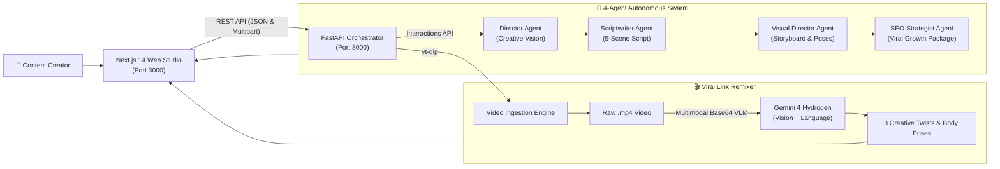

# 🎬 Creator OS — Your Personal AI Creative Studio & Autonomous Viral Remixer

> *"From a random idea or viral link to a creative masterpiece. AI handles the workflow. Humans own the creativity."*

[](https://python.org)
[](https://fastapi.tiangolo.com)
[](https://nextjs.org)
[](https://www.typescriptlang.org)
[](https://tailwindcss.com)
[](https://ai.google.dev)

---

## 🏗️ System Architecture



---

## ⚡ Flagship Features

1. **✨ Blank-Slate Idea-to-Masterpiece Studio:**
   - Transform a raw text prompt, voice note, or reference concept into a full creative direction, 5-scene dialogue script, visual storyboard with color palettes and camera angles, 7-day publishing schedule, and cross-platform SEO package.
2. **🎬 Viral Link Remixer (Multimodal VLM Intelligence):**
   - Ingest any Instagram Reel, YouTube Short, or TikTok link (or direct `.mp4` upload).
   - Our Vision-Language model diagnoses why the video captivated millions and generates **3 distinct Creative Twists**, **exact body poses & camera framing guides**, and **platform-tailored distribution tactics**.
3. **🧬 Creative DNA Personalization Engine:**
   - Calibrate the studio to your specific niche, visual aesthetic, content tone, target audience, and primary platforms. Every generated script, hook, and pose is mathematically aligned with your brand identity.
4. **🛠️ Critical Hackathon MVP Phase Switcher:**
   - An interactive toggle in the header switchable between `[🛠️ Phase 1: 50% MVP Checkpoint]` and `[🚀 Phase 2: 100% Final Build]`.
   - In **Phase 1**, core flagship studios are 100% active, while Idea Vault, Content Planner, and AI Co-Pilot showcase sleek in-progress overlay banners with interactive preview buttons.
   - In **Phase 2**, all 8 modules are instantly unlocked.

---

## 📦 Studio Modules

| Module | Route | Phase | Status | Capability |
|---|---|---|---|---|
| **Dashboard** | `/` | Phase 1 | 🟢 Active | Performance metrics, creator streaks, quick actions, recent activity |
| **Creative DNA** | `/dna` | Phase 1 | 🟢 Active | Niche, visual style, tone, audience & platform fingerprint engine |
| **AI Studio** | `/studio` | Phase 1 | 🟢 Active | Idea-to-Masterpiece & Viral Link Remixer with live 4-Agent Swarm feed |
| **Script Studio** | `/script` | Phase 1 | 🟢 Active | 3-pane scene selector, dialogue script editor, storyboard preview & PDF export |
| **Caption & SEO** | `/seo` | Phase 1 | 🟢 Active | Platform tabs (IG, YT, TikTok, LinkedIn), character counters & 1-click copy |
| **Idea Vault** | `/vault` | Phase 2 | 🟡 Live + Banner | Tag-filtered masonry repository of scripts, concepts, and hooks |
| **Content Planner** | `/planner` | Phase 2 | 🟡 Live + Banner | 6-stage Kanban board (Ideas ➔ Scripting ➔ Filming ➔ Editing ➔ Scheduled ➔ Published) |
| **AI Creative Co-Pilot** | `/copilot` | Phase 2 | 🟡 Live + Banner | Real-time conversational creative strategist with quick prompt suggestions |

---

## 🛠️ Tech Stack

| Layer | Technology | Purpose |
|---|---|---|
| **Frontend Framework** | Next.js 14.2 (App Router) | Server-rendered React interface with modern file-system routing |
| **Language** | TypeScript 5.0 | End-to-end type safety matching backend Pydantic schemas |
| **Styling & Design System** | Tailwind CSS 3.4 | Deep `#07080F` dark mode, glassmorphism, ambient violet/cyan radial glows |
| **Iconography & Motion** | Lucide React + CSS Keyframes | Intuitive iconography with shimmer skeletons and agent transition feeds |
| **Backend Framework** | FastAPI 0.115+ (Python) | High-concurrency async REST API with CORS and multipart handling |
| **AI Foundation** | `google-genai` SDK + `gemini-4-hydrogen` | Frontier multimodal reasoning, Interactions API, and 4-agent swarm pipeline |
| **Video Engine** | `yt-dlp` | Safe extraction of high-resolution reels, shorts, and video clips |

---

## 📡 API Reference

| Method | Endpoint | Description |
|---|---|---|
| `GET` | `/` | API status and root greeting |
| `GET` | `/api/health` | Model health verification (`gemini-4-hydrogen` status) |
| `POST` | `/api/generate` | Executes 4-Agent Swarm Idea-to-Masterpiece pipeline |
| `POST` | `/api/remix-video` | Multimodal VLM video analysis and Creative Twist generator |
| `POST` | `/api/chat` | AI Creative Co-Pilot conversational endpoint |
| `GET` | `/api/vault` | Fetches saved creative ideas and concepts |
| `POST` | `/api/vault` | Persists a new idea to the Idea Vault |

---

## 🚀 Quick Start Guide

### 1. Clone & Configure
```bash
git clone https://github.com/your-username/CreatorOS.git
cd CreatorOS
```

### 2. Launch Backend
```bash
cd backend
python3 -m venv venv
source venv/bin/activate
pip install -r requirements.txt
cp .env.example .env
# Set GEMINI_API_KEY in backend/.env
uvicorn main:app --host 0.0.0.0 --port 8000 --reload
```
*Backend runs on `http://localhost:8000` (Verify via `http://localhost:8000/api/health`).*

### 3. Launch Frontend
```bash
cd ../frontend
npm install
npm run dev
```
*Frontend runs on `http://localhost:3000`.*

---

## ✅ Hackathon MVP Checklist

- [x] FastAPI async backend with clean modular architecture
- [x] Multimodal video analysis powered by `gemini-4-hydrogen` via `google-genai` Interactions API
- [x] 4-Agent Swarm execution: Director ➔ Scriptwriter ➔ Visual Director ➔ SEO Strategist
- [x] Safe `yt-dlp` video downloader wrapper with `.mp4` upload fallback
- [x] Rich `sample_demo.json` fallback ensuring zero-failure offline presentation
- [x] Creative DNA profile personalization engine across all generation streams
- [x] Next.js 14 App Router dark mode UI (`#07080F`) with violet/cyan radial backdrops
- [x] Interactive Phase Switcher in header (`50% MVP` vs `100% Final Build`)
- [x] All 8 functional studio modules completed and routed
- [x] Live animated Agent Swarm progress feed in Studio
- [x] Strict `.gitignore` protecting API credentials
